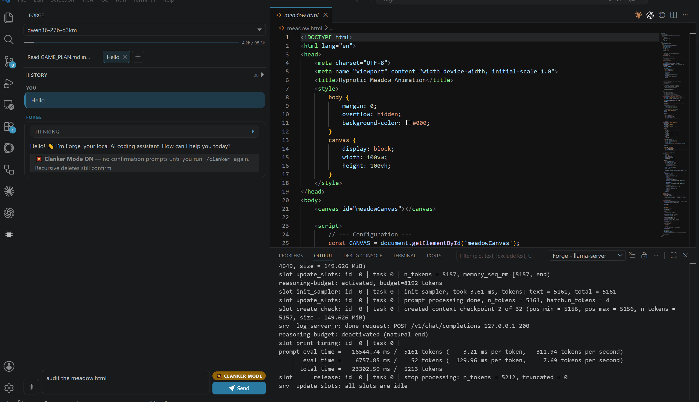
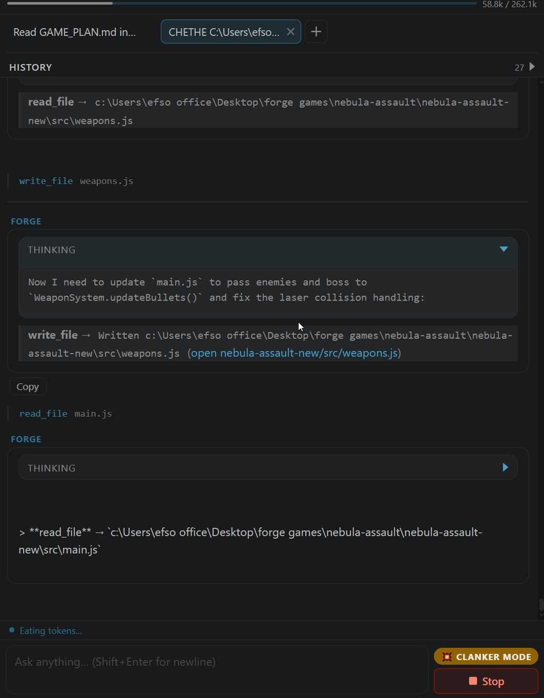
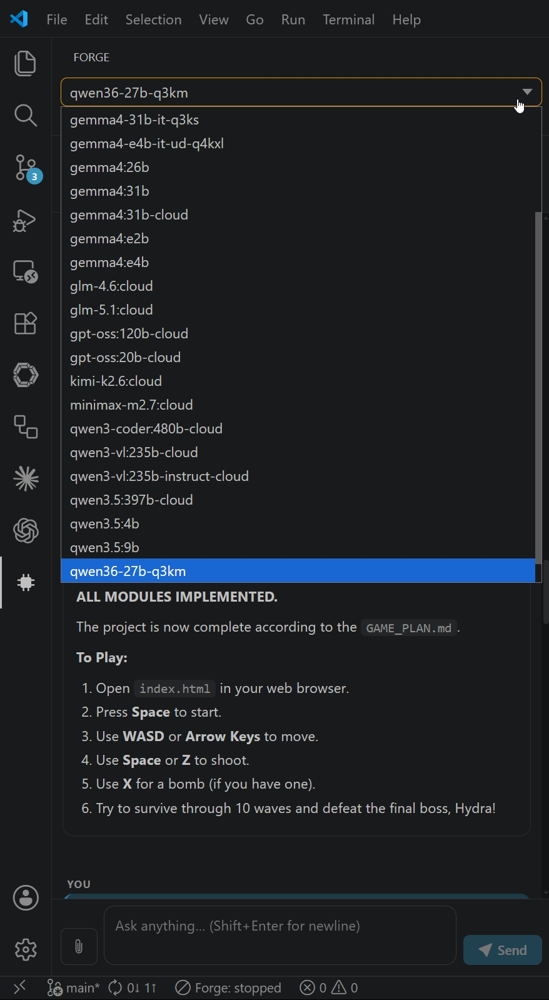
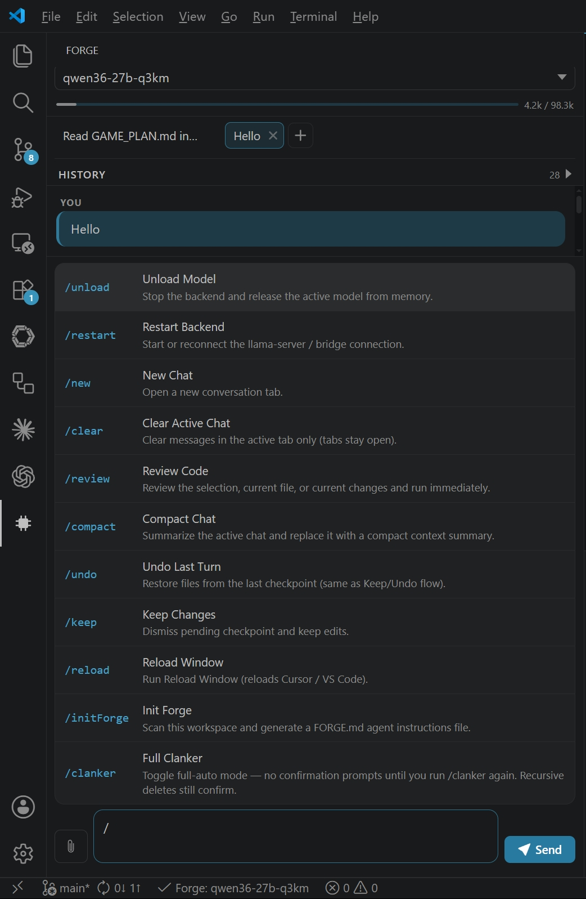
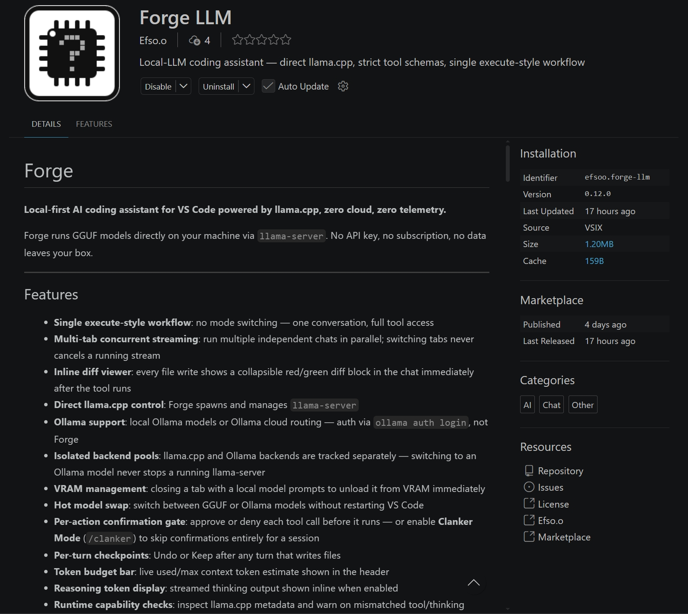

# Forge LLM

[](https://marketplace.visualstudio.com/items?itemName=Efsoo.forge-llm)
[](https://open-vsx.org/extension/Efsoo/forge-llm)
[](https://marketplace.visualstudio.com/items?itemName=Efsoo.forge-llm)
[](LICENSE)

> **The VS Code coding agent built for people who run their own models.**

Load GGUF models through llama.cpp, share one loaded model across VS Code
windows, use tool calling hardened for local-model context limits, and review
file-changing turns with visible diffs and Keep/Undo checkpoints. Forge itself
sends no telemetry and requires no cloud account.

This is the official Forge LLM extension by [Efsoo](https://github.com/Efs-O),
licensed under Apache License 2.0. Cloud and OpenAI-compatible providers are
available only when you explicitly configure them.

## Why Forge

- **First-class llama.cpp control.** Forge starts, monitors, shares, restarts,
  and unloads `llama-server`; it does not treat your local runtime as merely
  another API URL.
- **Tools engineered for local models.** Strict schemas, per-slot context
  budgeting, truncated-call recovery, bounded results, and chunked writes keep
  smaller local models productive through long coding turns. A cut-off tool call
  is never dispatched as if it had run: it is retried smaller, with thinking
  temporarily suppressed so the retry has more room than the attempt that
  failed. What each of these actually does is in
  [docs/LOCAL_MODEL_OPTIMIZATIONS.md](docs/LOCAL_MODEL_OPTIMIZATIONS.md).
- **Reversible agent work.** Confirmation gates, inline diffs, and per-turn
  Keep/Undo checkpoints make file-changing actions visible and recoverable.
- **Bring the runtime you prefer.** Use direct GGUF loading, local or
  daemon-routed Ollama, an explicitly configured OpenAI-compatible provider, or
  an already-authenticated Claude Code or Codex CLI.
- **Local and frontier agents working together.** The agent mesh connects
  Forge to Claude Code, Codex and Copilot sessions on the same machine, each
  signed in with its own CLI login. Your local model can ask the Codex or Claude
  session you already have open (with its project context) and get the answer
  back, and those sessions can message, check on, or steer Forge in return. See
  [the agent mesh](#the-agent-mesh).
- **Depth, not a chat box.** Background execution, LSP-backed code
  intelligence, terminal awareness in both directions, git, vision, and durable
  memory — see [what the agent can do](#what-the-agent-can-do).
- **It follows you out of the room.** Optional Telegram control with
  authenticator-based session locking lets you run a turn, answer its approval
  gate, and read the diff from your phone.

Local execution is the default. Search, fetch, cloud providers, and external
CLI agents run only when you configure or invoke them, and Forge itself sends
no telemetry, analytics, or auto-update pings.



## Screenshots

|          Agent loop + Clanker Mode          |                  Model picker                   |
| :-----------------------------------------: | :---------------------------------------------: |
|  |  |

|                   Slash commands                    |                  Marketplace                  |
| :-------------------------------------------------: | :-------------------------------------------: |
|  |  |

## Highlights

- Single execute-style workflow with no mode switching
- Multiple conversations with independent streaming, all available from history
- Per-action confirmation gate, plus `/clanker`, which turns confirmations off for
  one chat at a time
- Per-turn checkpoints with Keep and Undo
- Inline chat diffs after write tools
- Background execution: start a long command, keep working, monitor it as it runs
- Persistent agent jobs that outlive the window: a scheduled wake that can run
  an agent turn, and a job you pause, run or delete from the phone
  (`manage_jobs`, `/jobs` and `/job`) — see
  [jobs](docs/JOBS.md)
- A task plan the agent keeps, re-injected verbatim so a context compaction cannot lose it
- Demand-loaded tool groups, so a large tool surface costs starting context only when used
- Terminal awareness: the agent sees the commands you run and how its own turned out
- Frame extraction from workspace video for vision models (`view_video`, needs ffmpeg)
- Direct `llama-server` lifecycle management
- Ollama local and Ollama cloud routing through the local daemon
- Optional cloud or self-hosted providers: `openrouter`, `openai`, `openai-compatible`
- External CLI agents (`provider: cli` — Claude Code, Codex) as full-rights agents — both in direct chat and as `ask_local_agent` delegation targets, where they can read and edit the workspace with their own tools — using each CLI's own authentication. See [delegation](docs/DELEGATION.md) for which runs Keep/Undo covers
- Agent mesh: two-way messaging between Forge and Claude Code, Codex and Copilot sessions (`ask_agent`, plus the fifteen verbs in `forge.sh`'s own usage header)
- Localhost control server for external orchestrators and shared model lifecycle
- Reasoning token display and optional thinking-channel stripping
- Optional Tavily web search with the key stored in VS Code SecretStorage
- Local semantic code search and reindex support
- External MCP tool servers: bridge tools from any MCP stdio server into the agent's tool catalog with explicit capability classification
- Optional private-owner remote control through Telegram: local pairing,
  Google Authenticator-compatible session locking, approval gates and live
  progress on your phone — see [run it from your phone](#run-it-from-your-phone)
- LSP-backed code intelligence: definitions, references, implementations,
  diagnostics, code actions, and symbol rename through VS Code's own language servers
- Durable agent memory across sessions (`remember` / `recall`)

## Skills

Skills are folders containing a `SKILL.md` with `name` and `description`
frontmatter, plus optional `scripts/`. They use the same format as Claude Code
and Codex. Forge lists shipped skills, then skills in `~/.forge/skills/<name>/`,
then `.forge/skills/<name>/` in the open workspace. When two folders have the
same name, the later location wins.

New skills appear in the next new chat because Forge builds the catalog once per
conversation. Skills grant no permissions: scripts run through `shell` under
the normal approvals. The skill files themselves are not gated: the agent can
write under `~/.forge/skills/` with no approval card and no policy line, so it
can edit a skill that later steers it or another chat. Skills are on by
default; set `skills.enabled: false` in `config.yaml` to turn them off. For a
worked example to copy, see
[hf-download](resources/skills/hf-download/).

## What's New

Forge ships a **Changelog** tab next to this one — that is the full account,
every release. The short version of the current 0.17 line: persistent scheduled
agent jobs, listed and acted on from the phone with `/jobs` and `/job`, or by
asking the agent with `manage_jobs` (the sidebar has no jobs command); two-way
messaging with Claude Code, Codex and Copilot sessions (`ask_agent`,
`forge.sh`); local stable-diffusion image generation and upscaling beside the
billed cloud one; browser and desktop tools; terminal awareness in both
directions; a jobs scheduler that owns the machine's wake timer; and remote
VS Code windows that hand a phone session to the desktop window that owns the
models.

## What the agent can do

Ninety native tools, all strict-schema, all permission-gated, and all
advertised per round rather than per turn — so a capability you enable becomes
usable immediately. Groups an agent rarely needs are demand-loaded through
`load_tool_group` and cost no context until called.

The first load in a conversation pauses while the model re-reads its context:
about **100 seconds at 70K tokens** and **190 seconds at 120K tokens** on the
reference machine (Qwen3.8-27B, measured on llama.cpp b11243). Only rarely used
groups use this path; reading, writing, editing, searching, `shell` and the
background tools stay available by default. As of this build the `git` group —
including `git_read` — and the `media` group (images, video, rendering,
`send_file`) also load on demand, because 53 sessions since 0.17.80 used
`git_read` 6 times against 418 `git` commands typed into `shell`, and used four
of the media tools 0 times. A profile that runs git through the tools, or
reviews and makes images, keeps them advertised with
`tool_groups.eager: [git, media]`.

**Files and edits.** `read_file`, `write_file` — `mode: "append"` adds to the
end of a file, which is how a write that was cut off is finished — `edit_file` with
batched `edits[]`, `apply_line_edits`, `move_file`,
`list_directory`. `delete_file` moves to the recycle bin rather
than destroying. Every write is checkpointed and shown as a diff.

**Code intelligence, through VS Code's own language servers** — not grep
heuristics. `code_intel` handles diagnostics, document/workspace symbols, hover,
definitions, references, implementations and code actions. `apply_code_action`,
`rename_symbol` and `format_file` remain separate write tools. The agent sees the same analysis your editor does, so it answers
"who implements this?" instead of guessing from a name.
Its operation values are `diagnostics`, `document_symbols`, `workspace_symbols`,
`hover`, `definition`, `references`, `implementations` and `code_actions`.

**Search.** `grep_search` and `find_files` (both ripgrep — one index, so they
cannot disagree), plus `search_codebase` for local semantic search over your
own embeddings.

**Shell.** One `shell` tool runs a command line in your configured shell
(`permissions.exec.shell`; unset means bash, which on Windows is always Git
Bash and never WSL, or pwsh on a Windows machine without Git for Windows; a
single call can pick the other). Every
command is classified first: reads (`git status`, `rg`, `Get-Content`, `ls`)
run without asking, ordinary commands ask unless the chat you are in has
`/clanker` on, destructive ones always ask (in a Clanker chat too), and a few are
refused outright. Output over 30K characters
keeps its head and tail and spills the full text to a file the agent can read.

**Background execution.** `shell` with `background: true` starts a
long-running command and returns immediately; `monitor_execution` reads its output as it accumulates,
`list_executions` recovers an id the agent lost, `stop_execution` ends it. Also
`wait`, for the gap nothing else covers: giving a dev server you just launched
or a file you just wrote a moment to become observable, instead of retrying a
check that cannot succeed yet.

**Terminal awareness.** The agent _sees the commands you run yourself_ in VS
Code's terminal — including the ones that failed — so it corrects them in chat
instead of asking you to paste output it already has.

**Git.** `git_read` handles status, diff, log, blame and show (including a file
at any past commit). `restore_file` (brings a path back from a commit,
checkpointed), `stage`, `commit` (including `amend`), `create_branch` and
`switch_branch` remain separate tools. Git reads run the CLI directly; the VS
Code Git extension is not required.
Its operation values are `status`, `log`, `diff`, `blame` and `show`.

**Delegation.** `ask_local_agent` hands a task to another configured model or
CLI agent; `list_delegation_targets` lists them on demand instead of spending
schema on every turn. Local and cloud targets get the task and context files
only. Claude Code and Codex run with their own tools and can edit files.
`ask_agent` reaches a Claude Code, Codex or Copilot session linked to the
current Forge chat, or creates a Forge-owned session when none is linked — see
[the agent mesh](#the-agent-mesh).

**Images.** `generate_image` appears only when an `image_generation:` backend
is configured. A cloud backend asks for approval on every call because each
image is billed; a local stable-diffusion.cpp backend is free per image and asks
once before it occupies the GPU (`confirm_on_start`). Setup for both is in
[AI_SETUP.md](AI_SETUP.md), step 10.

**Editor context.** `get_editor_context` lets the agent read the file and
selection you are actually looking at; the edit tools then write that file by
name, and `show_diff` shows two versions side by side.

**Vision.** `view_image` for screenshots and diagrams, `view_video` for frames
sampled out of a workspace clip (needs ffmpeg), and `image_search` for finding
where a picture appears online — a reverse search against Google Lens or Yandex
on an attachment or a public URL, needing an `image_search:` block with a
SerpApi key.

**Video and music.** Optional local `generate_video` and `generate_music` tools
make short clips and music tracks with configured engines on the user's own
hardware. Setup, model paths, GPU needs and what source audio does are covered in
[media generation](docs/MEDIA.md).

**Browser and desktop.** Computer-use tools require a vision model and the
corresponding `permissions.browser.enabled` or `permissions.desktop.enabled`
setting. Desktop tools click and type into whichever window is focused.

**Memory that outlives the conversation.** `remember`, `recall`, and
`list_memories` give the agent durable notes across sessions, separate from
transcript history. Memories are markdown files under `~/.forge/memories/`;
older ones are moved there from VS Code storage once. If that move fails, Forge
says so and keeps serving memories from VS Code storage: any files already
written under `~/.forge/memories/` are not the live store, and the move will
retry next load.

**A task plan that survives compaction.** `update_plan` records the work as
conversation state, re-injected verbatim every round and never summarized — so
a context compaction costs at most one stale item instead of the whole thread.

**Reaching you.** `notify_user` and `show_notification` reach whichever surface
started the turn — the sidebar, or your phone. `ask_user` asks a real question,
or several related ones in a single round.

**Web, when you configure it.** `web_search` (DuckDuckGo by default, Tavily with your key) and
`web_fetch`.

## Run it from your phone

Optional, off by default, and it opens no inbound port: Forge makes an
**outbound** connection to Telegram, and VS Code has to stay running. Full
setup and threat model in
[remote control](docs/REMOTE_CONTROL.md).

Once paired you have a real Forge session in a private chat — send a prompt,
watch live agent and compaction progress, resolve approval gates from the
phone or the desktop (first resolution wins), and send attachments.

**Locked behind two gates.** One exactly-matched provider user ID is paired,
private chats only, group and channel messages fail closed. Pairing is an
eight-digit one-time code that expires in five minutes and stops accepting
guesses after five tries. On top of that, an enrolled
**Google Authenticator-compatible TOTP secret**: the QR is displayed locally and
never sent through Telegram, the session starts locked after every reload,
re-locks on an inactivity timeout you set with `/timeout`, and `/lock` ends it
on demand. Bot token and owner ID live in SecretStorage; the session and its
replay protection are memory-only.

**Built to survive the transport.** Prompts, deduplication records, and the
provider cursor are durable, and the update offset advances only after Forge
has genuinely accepted, handled, rejected or recognised an event as a
duplicate — a dropped connection re-delivers rather than loses, and a
re-delivery is recognised rather than run twice. Final responses go out through
an at-least-once outbox. One fenced lease stops two VS Code windows consuming
the same bot.

**Talk to it.** Send a voice note and it is transcribed and run as a prompt;
`/voice` turns spoken replies on, synthesized locally with Piper. Both
directions stay on your machine — the same rule as everything else here. A
voice note from an unpaired sender is rejected with a reason rather than
silence.

**Read it back.** `/view [n]` replays the last few exchanges into the chat.
Live progress is pushed as a single message edited in place, so a phone that
was asleep sees the final state and never the edits it missed — `/view` is the
pull that covers that gap. `/system` reports GPU, VRAM by process, RAM and
drives, which is how you find out from a train why the model will not load.

**Commands.** `/status`, `/context`, `/system`, `/view`, `/stop` (cancels the
running turn; plain text reaches it at its next step), `/new`,
`/chats`, `/chat`, `/resume`, `/agents`, `/answer`, `/claude`, `/codex`,
`/copilot`, `/tell`, `/model`, `/chatmode`, `/queue`, `/drop`,
`/ratelimit`, `/unload`, `/unloadall`, `/restart`, `/jobs`, `/job`, `/reload`,
`/compact`, `/lock`, `/speed`, `/timeout`, `/notify`, `/mirror`, `/voice`,
`/clanker on|off`, `/workspace`, `/contacts`, `/contact`, `/send`,
`/sleep`, `/wake`, `/approvals`, `/help`, `/media`, `/music`, `/video`. Telegram shows them in its native command menu, and
`/help` prints the same list grouped by section; the list itself lives in
`src/remote/remoteHelpText.ts`.

**`/sleep` and `/wake` need hardware Forge does not ship.** `/sleep` suspends
the machine; waking one that is suspended cannot be done by software running on
it, so `/wake` is answered by a separate always-on device on the same LAN that
sends the magic packet. Forge's half is a private-LAN receiver, off unless you
configure `remote.wake_relay`, and it authenticates every request with an
HMAC-SHA-256 signature over a timestamp and nonce whose secret lives in
SecretStorage.

The audit log is metadata only — timestamps, channel, action, request id, and
truncated identity hashes. No prompt text, no responses, no secrets, no paths.

WhatsApp exists as a separately opt-in experimental linked-device adapter.

## Use Forge from another computer

Two ways to work when the models, the files and the GPU live on one computer —
the **main** machine — and you are typing on a second one.

**A. A VS Code Remote window onto the main machine.** Start a tunnel on the main
machine (`code tunnel`), pick it in Remote Explorer on the second computer and
open the workspace there. The extension host runs on the main machine, so Forge
sees its files, its models and its GPUs; the machine you type on only draws the
sidebar.

- `forge.configFile` is **machine**-scoped: a Remote window reads it from the
  **Remote settings** of the machine it connects to, not from the one you type
  on. Unset, the workspace's own `.forge/config.yaml` is used.
- **Keys are per computer.** A window reads the keychain of the machine you are
  typing on — VS Code stores secrets on the client, wherever the extension host
  runs — so the main machine's own window is the one that already holds them: a
  key-based cloud model in a remote window goes through that window's cloud
  relay, and key-based image generation is not available in a remote window.
- **Only a tunnel or SSH window is that case.** A WSL, Dev Container, attached
  container or Codespaces window runs on the machine being typed on, or in a VM
  with no second Forge window, so it keeps its own transports, wake relay,
  starter, cloud relay and keyed cloud models.
- **Telegram stays in the main machine's own window:** a remote window starts no
  transport and takes no lease, so the phone bot keeps answering.

**B. Forge on the second computer, with entries that point at the main one.**
The second machine keeps its own window, conversations and workspace, and asks
the main machine for models — the shape for a laptop you carry.

Set it up with three commands. The only thing Forge cannot do for you is the ACL
rule, and that is one line in the Tailscale admin page:

1. **On the main machine, in its own Forge window:** `Forge: Share this computer`.
   It turns on `model_starter` and `cloud_relay` in that machine's config (one
   comment-preserving write) and shares exactly those two ports with
   `tailscale serve`, after showing you the commands and asking you to confirm
   them. It never shares Forge's control port or Ollama's daemon port, never
   changes the Tailscale ACL, Tailnet Lock or sign-in, and does nothing in a
   tunnel or SSH window — run it in the desktop's own window. Until an ACL rule
   lets the second computer reach those two ports, sharing is on and the laptop
   still cannot connect. `Forge: Stop sharing this computer` turns both switches
   off, removes the two shares Forge made, and leaves every other share this
   computer has on the tailnet exactly as it was.
2. **On the second computer:** `Forge: Connect to my desktop`. It finds the
   desktop through `tailscale status --json` (or the starter addresses already in
   your config), reads the models the desktop reports and the cloud models its
   relay allows, and writes all of them into your `config.yaml` in one
   comment-preserving write: no keys, and nothing started, so a sleeping desktop
   stays asleep. An entry that already exists is left exactly as it was, so
   running it again adds nothing and says "already there".
3. **On the second computer, when something does not work:** `Forge: Check
connection`. It walks the path — Tailscale here, the desktop online in
   Tailscale, the model starter, the cloud relay, the models the desktop will
   serve — and names the first link that is broken, in words you can act on. It
   starts nothing to make that answer, and writes nothing.

A laptop that has connected also says once per window when the desktop has gained
a model this laptop does not list, with `Add them` to write it.

Set up by hand instead — the fallback for a machine that cannot run the commands
(older build, or a headless window). The main machine publishes two services,
both loopback-only:

```yaml
# partial: the model_starter and cloud_relay blocks only, not a whole config
# the main machine's .forge/config.yaml
model_starter:
  enabled: true # absent block or false = nothing listens
  port: 8798 # must equal `tailscale serve --tcp 8798`
  shared_ports: [8080, 8081, 8090] # must equal the ACL's dst ports
  lease_ttl_s: 600 # how long a started model stays held

cloud_relay:
  enabled: true
  port: 8797 # chat only; no key leaves this machine
  models: [grok-code-fast, llama3:cloud] # names THIS config knows
```

- `model_starter` lets the other computer **start** a model it cannot start
  itself: `POST /ensure` loads or starts it and answers with the port to use;
  `POST /release` and `POST /unload` give it back. The lease protects the model
  from eviction, and from `stop_on_exit`, until it lapses.
- `cloud_relay` lets it **use** key-based cloud models with no keys on it: it
  forwards chat requests and resolves the token here.

Both bind `127.0.0.1` only, like every Forge listener. Reach them through
`tailscale serve`, which forwards a shared port to that loopback address, with
the ACL limited to the second computer. Never expose Forge's control port
(`control_server`, 8799): it is loopback-only.

The second computer's entries:

```yaml
# the second computer's .forge/config.yaml
models:
  - name: strata-iq3s
    provider: openai-compatible
    endpoint: http://100.64.0.10:8090 # host only; /ensure reports the port
    remote_start:
      starter: [http://192.0.2.10:8798, http://100.64.0.10:8798] # LAN first
      model: strata-iq3s # the name the MAIN config knows it by
    num_ctx: 32768 # = the `context` /models reports

  - name: grok-code-fast # must be spelled the same on both machines
    provider: openai-compatible
    endpoint: http://100.64.0.10:8797 # the cloud relay, not the provider
```

`starter` is one address or 1-4 of them, tried in the order written, each an
`http://` URL with an IP host — a name fails the listener's own anti-rebinding
check. `endpoint` must name one of those hosts, and `/ensure` replaces its port,
so a llama.cpp slot port is never guessed. A `Forge: Connect to my desktop`
entry names the shared port instead — `endpoint: http://100.64.0.10:8798/strata-iq3s`
— and the starter forwards that request to the model's own port one loopback hop
away, so no model port has to be shared at all. Only models the main machine marks
`remote: true` start this way: its own llama.cpp models and the servers it
manages, with every slot port in `shared_ports`; Ollama, cloud, CLI-agent and
unshared-port models answer `remote: false` with a reason. A cloud entry with no
`remote_start` dials the relay, and the relay looks the model up by the name in
the request — what Forge sends is the entry's name, so the two machines must
spell it the same; a `model:` field on the entry does not change that.

**Waking the main machine.** Nothing on a sleeping machine can wake it, and a
magic packet does not cross a router, so pick how it gets woken:

| Option                                   | Needs                                                                                                                                                                                          | Who asks for it                                       |
| ---------------------------------------- | ---------------------------------------------------------------------------------------------------------------------------------------------------------------------------------------------- | ----------------------------------------------------- |
| Wake-on-LAN magic packet                 | the adapter armed for WoL, and an always-on device on the same LAN                                                                                                                             | a phone WoL app, another machine, a small board       |
| Forge's wake relay (`remote.wake_relay`) | an always-on device on the same LAN holding the Telegram side and the magic packet; Forge binds `host`:`port` on the machine to be slept and accepts a signed `/v1/sleep` only from `relay_ip` | Telegram `/sleep` and `/wake` from your phone         |
| An RTC wake timer                        | wake timers allowed in the power scheme, armed **before** it sleeps                                                                                                                            | `schedule_wake` in a turn, or `/sleep 8h` on Telegram |
| A recurring wake task                    | the same permission; the jobs scheduler owns `ForgeScheduledWake` and deletes it when no job asks for a wake                                                                                   | a scheduled job with a wake time                      |

## Requirements

- VS Code 1.90 or later
- One of:
  - `llama-server` plus one or more GGUF files
  - a running Ollama daemon
  - an already-running OpenAI-compatible server
  - an explicitly configured cloud provider model
  - an authenticated Claude Code or Codex CLI for `provider: cli`
  - an authenticated Claude Code, Codex or Copilot CLI for the agent mesh

### Optional: ffmpeg, for `view_video`

The `view_video` tool samples still frames from a workspace video clip and sends
them to a vision model. It needs **ffmpeg and ffprobe** on `PATH` (Windows:
`winget install Gyan.FFmpeg`; macOS: `brew install ffmpeg`), or an explicit
`video.ffmpeg_path` in `config.yaml`. Nothing else in Forge uses ffmpeg, so
skip it if you do not need video.

Frames cost prompt tokens — an unscaled 1080p clip can exceed a 16k context on
its own. `video.frame_max_dimension` (default 640) is the knob; see the measured
table in `config/config.example.yaml`.

### Optional: Claude Code and Codex

Forge runs the `claude` and `codex` **CLIs** directly, not their VS Code
extensions, so:

1. **Install each CLI and log in with it**: run `claude` once and sign in, and run `codex login`. Forge
   never holds their keys; each uses its own login.
2. **Have them in `config.yaml`.** The setup wizard adds them when it finds
   them on `PATH`. To add them by hand:
   ```yaml
   models:
     - name: claude-code
       provider: cli
       cli: claude # bare name, or a full path to the executable. A .cmd shim is run through its launcher, which needs Node on PATH
     - name: codex
       provider: cli
       cli: codex # bare name, or a full path to the executable. A .cmd shim is run through its launcher, which needs Node on PATH
   ```
   For `ask_local_agent` delegation, also set `permissions.agents.delegate: true`.
3. **If you run Claude Code in bypass-permissions mode**, add
   `"crossSessionInbound": "accept"` to `~/.claude/settings.json`. Otherwise a
   message Forge sends to your open Claude session waits for your approval there.
4. **Windows:** Codex needs PowerShell 7 installed from the **MSI** (the
   Microsoft Store package does not work), and the `~/.forge/agent-bus/forge.sh`
   client needs **Git Bash** — in PowerShell a bare `bash` is WSL.

5. **For the agent mesh** (`forge.sh`), check that the control server and bus are
   enabled. New starter configs enable both; older configs may need:
   ```yaml
   # partial: the control_server and agent_bus blocks only, not a whole config
   control_server:
     enabled: true
   agent_bus:
     enabled: true
   ```

Nothing needs to go into Claude's memory: Forge writes its agent-bus notes to
`~/.forge/agent-bus/`, and every question it sends carries reply instructions.
Read the live `forge.sh` usage header before using it; there is no `join`
command.

For Codex or Claude Code to discover the mesh in every new session, Forge
writes its own agent-bus note into a marked section between two
`forge-agent-mesh` comment lines — `<!-- forge-agent-mesh:start -->` and
`<!-- forge-agent-mesh:end -->` — in every `AGENTS.md` and `CLAUDE.md` the
workspace has, creating `AGENTS.md` when neither exists. The first start in a
workspace with `agent_bus` on does this, and a later start refreshes that section
when Forge's note text changes, so the section is Forge's to keep current, not
yours: everything outside the two comment lines is yours, and deleting the text
between them keeps it deleted. **Forge: Set Up Agent Note** re-runs the install
on demand. The section reads:

> When asked to message Forge or another agent, read
> `~/.forge/agent-bus/README.md` and the leading usage header of
> `~/.forge/agent-bus/forge.sh` first. Use your own agent name with `say` or
> `send` (`claude` in Claude Code, `codex` in Codex). `send` to another agent
> reaches only the recipient linked to the Forge chat your session last
> addressed (one session may hold several chats); check `who` and the intended
> chat's links before sending. A 202 exchange id confirms
> acceptance, not an answer; read the verdict or failure. There is no `join`
> command. `send` goes to that agent's session for your current Forge chat: the
> session already linked if there is one, a new Forge-started one if there is
> none, and you cannot choose which instance answers. On Windows run the client
> through Git Bash by full path — `& "$(git --exec-path)/../../../bin/bash.exe"`
> or `C:\Program Files\Git\bin\bash.exe` — never a bare `bash`: in PowerShell
> that is usually WSL, whose home is not the Windows `~/.forge` folder, and if
> `Get-Command git.exe` finds nothing the mesh needs Git for Windows first
> (`winget install --id Git.Git -e`).

**Model and effort for a Forge-owned Codex/Claude session.** With no session
linked to the chat, Forge may create its own Codex or Claude CLI process (the
agent-bus mesh, above); by default it runs each CLI's own configured default
model and effort. These optional `agent_bus:` keys pick them instead:

```yaml
# partial: the agent_bus block only, not a whole config
agent_bus:
  codex_model: gpt-6-luna
  codex_effort: high # low | medium | high | xhigh | max
  claude_model: opus
  claude_effort: high
  copilot_model: auto # the default; see below
```

`copilot_model` is the exception: it defaults to `auto`, because with no
`--model` the Copilot CLI runs its premium default model on every call. Set it
to a model name to pin one.

Unset keys keep today's behaviour: Forge passes nothing and the CLI's own
config decides. A change applies at the next owned-session creation, not to a
session already running. Codex/Claude reject an unknown model or effort value the same
way they would from a terminal; Forge surfaces that error unchanged.

## Backend Modes

### 1. Direct GGUF mode

Forge starts and manages `llama-server` itself.

Best for:

- local GGUF workflows
- direct control over server args
- keeping everything on your own machine

### 2. Ollama mode

Forge talks to the local Ollama daemon at `http://127.0.0.1:11434`.

Best for:

- local Ollama models
- Ollama cloud routes after `ollama auth login`
- users who want model management outside Forge

### 3. Optional cloud / OpenAI-compatible providers

Forge can also call explicitly configured cloud providers, or any
already-running OpenAI-compatible server (pre-managed local servers, custom
wrappers, external infra) via the `openai-compatible` provider with an
`endpoint`.

Supported provider values:

- `openrouter`
- `openai`
- `openai-compatible`

`openai-compatible` covers any endpoint that speaks the OpenAI chat API — for
example Cerebras Cloud (`endpoint: https://api.cerebras.ai`, key stored in
SecretStorage under the name you set as `api_key_secret`).

This is opt-in. Nothing uses a cloud provider unless you configure a model that points to one and provide its token through VS Code SecretStorage.

## Sharing one llama-server across windows

Opt-in, off unless you enable it:

```yaml
# partial: the shared_runtime block only, not a whole config
shared_runtime:
  enabled: true
```

A second VS Code window asking for a model another window already loaded
**borrows that running llama-server** instead of spawning its own. One copy of
the weights in VRAM. The borrowing window takes a lease; the owner will not shut
down while a lease is outstanding, and a lease left behind by a crashed window
is reclaimed once its process is confirmed gone.

Conversations are not shared — each window keeps its own open chats, messages and
checkpoints. **KV cache slots are**, and that is the part that surprises people:
alternating windows evict each other's cached prefix and each pays full prompt
re-processing. Answers stay correct; you lose the cache speedup.
[How sharing behaves in detail](docs/SHARED_RUNTIME.md) covers the slot maths,
what the token counter is really measuring, and why `max_simultaneous_models`
is not the setting for this.

## Quick Start

### 1. Install the extension

Install Forge from the VS Code Marketplace or Open VSX, or load the packaged VSIX.

**Easiest: let Claude Code or Codex set it up.** Run **Forge: Set Up With
Claude Code / Codex** from the Command Palette. It copies a prompt that points
your agent at `AI_SETUP.md`, which ships with the extension. The agent surveys
your GPU and model files, installs llama.cpp if you need it, writes the config,
and checks the result against Forge itself. It stops and asks you whenever a
step needs you: a window reload, a login, or a key, which you enter into VS Code
yourself and never into a file or the chat. The steps below are the manual
route.

### The two files: `config.yaml` and `~/.forge/policy.yaml`

Forge reads a pair. `config.yaml` — in the workspace, or in global storage — holds
the models, their tuning, profiles, aliases and groups: the things an agent may
edit. `~/.forge/policy.yaml` holds every setting that says what an agent may do:
the `permissions` block, the exec deny list, the fetch and search providers, the
host list (`model_hosts`), the MCP servers, the remote and job settings, and the
`engines` that say how a server process is started and stopped. Nothing under
`~/.forge/` is writable by an agent, so an agent cannot loosen the rules it is
judged by.

Until the split has been run, `config.yaml` still holds all of those keys, and that
file is owner-only as well. Run **`Forge: Move security settings to policy.yaml`**
to move them out — it backs up `config.yaml` first and refuses to overwrite a
policy file you wrote by hand — and that is what opens `config.yaml` to agents.
After it, a policy key left in `config.yaml`, a model that names its own
`start_command`, or a model `endpoint` on a host that is not loopback and not in
`model_hosts` makes the load fail, naming the key and the command that fixes it.

**`Forge: Lock policy.yaml`** makes the policy file read-only for this user, so an
in-place write is refused; **`Forge: Unlock policy.yaml`** puts it back. Both commands
are yours — Forge never locks on its own — and `/config` tells you which state the
file is in. While it is locked, any Forge feature that writes a policy key (a
llama.cpp install, `/chatMode`, a remote toggle) refuses with the unlock command
named instead of writing into `config.yaml` behind your back.

**Ask-once approvals.** A card's **Allow for this chat** button remembers only the
action the card showed, for that conversation; `/approvals` lists the chat's rules
and matching project rules, and `/approvals reset` clears the chat's remembered
rules. The owner can click **Always in this project** to save a matching rule in
`approvals.always` in `~/.forge/policy.yaml`. This is an owner action, not a model
tool. If the file is locked, Forge says **Unlock policy.yaml** and keeps the rule
for this chat only. Project policy rules are checked before chat rules and Clanker.

Scheduled jobs and the unattended bus turns a job relays to a peer chat cannot show an approval card or use chat
rules or Clanker. To allow a keyed action there, the owner adds it under
`approvals.jobs.<job-id>.allow` or `approvals.unattended_bus.allow` in
`~/.forge/policy.yaml`; a refusal names the exact line, and a rule for a removed
job produces a load warning naming that job id. Approval cards expire: a fresh
install writes `permissions.approval_timeout_minutes: 10` into `~/.forge/policy.yaml`,
so an unanswered card times out after 10 minutes and the tool result says so. On an
older install the key is absent — there a card waits until you answer, until you set
it. The value must be between 1 and 1440 minutes; to keep waiting forever, leave the
key out.

Say plainly what that lock does and does not do, because it is easy to over-trust. It
stops Forge's own writers being used as a proxy for the agent, and it stops your own
accidental edits. It does not stop a program running as you: you can always rewrite
the file's permissions without elevation, and `~/.forge` lets you replace a file you
may only read, so a script can still overwrite the policy. What actually keeps the
agent out is that nothing under `~/.forge/` is writable by it. A wall that would
survive a script needs the file moved into a folder owned by Administrators you
cannot delete from, which takes an elevated prompt — proposed, not built.

### 2. Create `.forge/config.yaml`

Forge looks for:

`<workspace>/.forge/config.yaml`

The setup wizard can generate it for you, or you can start from [`config/config.example.yaml`](config/config.example.yaml).

Minimal direct GGUF example:

```yaml
active_model: my-model

llama_server:
  binary: /path/to/llama-server
  host: 127.0.0.1
  port: 8080
  n_gpu_layers: 999 # -1 is auto-fit on current llama.cpp, not "all"
  default_num_ctx: 32768
  n_batch: 512
  n_parallel: 4
  type_k: q8_0
  type_v: q8_0
  flash_attn_default: true

models:
  - name: my-model
    gguf_path: /path/to/model.gguf
    num_ctx: 8192
    flash_attn: true
    think: false
    strip_thinking_channels: true
    sampling:
      temperature: 0.6
      top_p: 0.95
      top_k: 64
      max_tokens: 8192
```

Ollama example:

```yaml
models:
  - name: 'gemma4:26b'
    provider: ollama
    endpoint: http://127.0.0.1:11434
    num_ctx: 262144
    think: true
    reasoning_effort: medium
```

Already-running OpenAI-compatible server example:

```yaml
models:
  - name: my-local-server
    provider: openai-compatible
    endpoint: http://127.0.0.1:8080/v1
    api_key_secret: my-local-server-token # only if the server requires one
```

For larger examples, including control-server and cloud-provider patterns, use
[`config/config.example.yaml`](config/config.example.yaml).

### 3. Open the sidebar

Click the Forge icon in the activity bar and send a prompt.

If the config is missing or invalid, Forge will guide you through setup instead of silently failing.

The agent's tool activity is grouped by default: each run of steps folds into one summary row (open while the agent works, collapsed when the answer starts), and every step and diff expands on click. `forge.sidebar.activityView` switches to `compact` (one row per step, no grouping) or `full` (every call, thought and diff as its own row).

`forge.sidebar.retainContextWhenHidden` (on by default) keeps the chat's state when you hide the panel, `forge.sessions.autoArchiveMinutes` (30 by default) archives eligible background chats after that many inactive minutes (`0` disables it), `forge.thinkingDisplay` chooses how a model's reasoning is shown (`preview`, `open` or `collapsed`), `forge.editor.autoOpenChangedFiles` (off by default) opens each file Forge changes in the editor, and `forge.logLevel` sets how much the Forge output channel records (`trace`, `debug`, `info`, `warn`, `error`).

Switching chats does not archive the chat you leave. The selected chat stays open, and Keep open on a chat's row pins it until you choose Allow auto-archive. Running turns, pending work, drafts and staged attachments also prevent automatic archiving. Closing a chat with an unsent draft or attachments asks before discarding them. Composer drafts and staged attachments live only in the webview and do not survive a VS Code reload.

## Coding benchmark smoke test

Forge includes a one-task SWE-bench Verified smoke runner. Install the official
`swebench` package and Docker, copy `benchmarks/smoke-task.example.json` to
`benchmarks/smoke-task.json`, and pin one `instance_id` (and dataset revision).
Start the Qwen llama-server normally, then validate without model calls:

```powershell
npm run bench:smoke -- --dry-run
npm run bench:smoke
```

Use `--arms qwen-forge,qwen-minimal` for a local-only rehearsal. Each arm gets
an exact-base disposable checkout and writes logs, patch, evaluator output,
runtime facts, and usage under `results/<run-id>/<arm>/`. The report ranks this
single task only; one task is not a SWE-bench score, and published SWE figures
are not mixed into the local ranking.

Before spending evaluator or agent-session usage, ping both Qwen arms against
the served llama-server:

```powershell
npm run bench:ping
```

The ping command never launches Claude or Codex. It loads the Forge-configured
Qwen server for `qwen-forge`, unloads it, starts the same GGUF through Forge's
baseline direct lifecycle for `qwen-minimal`, and stores both replies and server
facts under `results/ping-<run-id>/`.

## Cloud and Token Setup

Cloud or hosted OpenAI-compatible providers are explicit and credentialed through SecretStorage, not YAML.

- Use `Forge: Set Cloud Provider Token` to store a bearer token.
- Set `api_key_secret` on the model entry in `config.yaml`.
- For `openai-compatible`, also set `endpoint`.

Example:

```yaml
models:
  - name: grok-code-fast
    provider: openai-compatible
    endpoint: https://api.x.ai/v1
    api_key_secret: xai

  - name: hosted-coder
    provider: openai-compatible
    endpoint: https://example-host/v1
    api_key_secret: hosted-coder-token
```

xAI has no provider of its own: reach it as openai-compatible, as above.

## Control Server

Forge can expose a localhost model-control API so an external orchestrator can ask it to load a model and report the active endpoint.

Example:

```yaml
# partial: the control_server block only, not a whole config
control_server:
  enabled: true
  port: 8799
```

Routes (loopback only):

- `GET /healthz` → `{"ok":true}`
- `GET /stats`
- `GET /models`
- `POST /ensure` with `{ "model": "..." }`
- `POST /release` with `{ "model": "..." }`
- `POST /unload` and `POST /chat` (the same chat API the model starter uses)
- `/agent/*` — the agent-bus routes, token-guarded and only present when
  `agent_bus.enabled`

This is especially useful in multi-process local setups where an external process needs Forge to warm or release a model on demand.

## Search and Semantic Code Search

Forge supports:

- Tavily search
- local semantic code search with a separate embedding model

Search API keys are stored in VS Code SecretStorage.

Use:

- `Forge: Set Search API Key`
- `/reindex` to rebuild the semantic index

## Image attachments

Image input requires a vision-capable model. For llama.cpp models, configure a
compatible `mmproj_path`; for other providers, declare the `vision` capability
only when that model accepts images. Forge stops before starting a request and
shows this setup guidance when an image is attached to a text-only model.

## MCP Tool Servers

Forge can consume tools from external [MCP](https://modelcontextprotocol.io) stdio servers. Configure them in `config.yaml`:

```yaml
# partial: the mcp_servers block only, not a whole config
mcp_servers:
  - name: my-mcp-server
    command: C:/path/to/my-mcp-server.exe
    # args: [--flag]              # optional
    # max_result_chars: 24000     # optional; default 24000
    # eager: true                 # optional; advertise its tools on every request instead of holding them behind load_tool_group
    # tool_permissions:           # optional; unlisted tools are read-only
    #   dispatch_subagent: delegate
```

On activation Forge spawns each server, auto-discovers its tools via the MCP handshake, and registers unclassified tools under the read-only permission tier — no per-server code needed. Classify a sensitive tool with `tool_permissions`; for example, `delegate` requires `permissions.agents.delegate: true` before the tool is advertised or dispatched. A server's tools are held behind `load_tool_group` (under a group named after the server) so a chat that never uses one does not pay its schemas every turn; set `eager: true` on a server you reach for constantly to advertise it on every request. Connection happens in the background: a slow or missing server binary never delays startup; its tools simply appear on the next chat turn once connected. A server that fails to connect logs an error and shows a warning toast, and duplicate tool names are skipped. Spawned server processes are stdio children of Forge (no network) and are terminated on extension deactivation.

Tool results are capped at `max_result_chars` (default 24000) before entering the conversation — oversized payloads are truncated with a visible marker so a verbose MCP server cannot overflow a local model's per-slot context window (`num_ctx / n_parallel` in direct llama.cpp mode).

When writing an MCP tool, see [Agent Tool Traps](docs/AGENT_TOOL_TRAPS.md) for failure modes to avoid.

## Local Delegation

Set `permissions.agents.delegate: true` and the primary agent can use
`ask_local_agent` to hand a task to another configured model. A llama.cpp or
Ollama delegate receives only the task and the workspace files you allow, has no
tools, and its answer comes back as advisory analysis. A `provider: cli`
delegate (Claude Code, Codex) runs unrestricted with the CLI's own tools and can
edit the workspace itself without Forge Keep/Undo coverage. A delegated run is
capped at 120 seconds for a local model, 300 seconds for a cloud one and 600
seconds for a CLI agent (`src/delegation/limits.ts`), and at 24,000 characters
of answer; a target that would load weights into
local VRAM asks you first.

A `provider: cli` model (Claude Code, Codex) is also a **full-rights direct
chat model**: Forge spawns the already-authenticated CLI locally and it runs
with its OWN tools — Forge does not inject its registry or run its tool loop for
it. Authentication is the CLI's own login, never a key held by Forge, and a
full-access CLI chat edits the live workspace without Forge Keep/Undo. Use the
CLI's own recovery features or Git for those changes.

## The agent mesh

`ask_local_agent` delegates a separate task. The mesh can reach a linked
Claude Code or Codex session you already have open, or a Forge-owned session.
Enable `control_server.enabled` and `agent_bus.enabled` (setup above).

- **Forge → them.** `ask_agent` asks the Claude, Codex or Copilot session linked
  to the current chat and waits for its answer. If none is linked, Forge creates
  a session for that chat. Use **Forge: Show Live Claude Sessions** to copy an
  existing Claude session id, then `/link` in the intended Forge chat to bind it.
- **Them → Forge.** From any terminal, `~/.forge/agent-bus/forge.sh` is the
  client, and its own leading comment block is the complete list of its fifteen
  verbs - Forge rewrites that header on every start, so read it before you
  message. It covers `say`, `send` and `send-file`, `steer` (interrupt) and
  `stop`, `reply`, `cancel`, `status`, `view`, `who`, `wait` (block until your
  chat is idle with nothing queued), `read-verdict` and `ack-verdict`, and
  `remote-ask` / `remote-notify`, which send a message or a question back to
  the Telegram chat that opened an exchange. `steer` and `stop` take
  `--to <conversationId>` to reach a chat other than the sender's default. One
  session may be linked to several Forge chats: `say` without `--to` goes to the
  chat that session last addressed, `--to` reaches any chat already linked to it
  (and links an open chat holding none), and `--new` starts a second chat while
  the first keeps its link.
- **`say` flags.** `--to <chat>` and `--to-running` pick which Forge chat gets
  the message and `--new` asks for a second chat; the three are mutually
  exclusive and the bus refuses a message that sets more than one with
  `choose one Forge chat target; new_chat cannot be combined with a target`
  (`src/backend/agentMessageOptions.ts:17-19`). `--new` needs a free chat tab:
  if that window is at its chat cap the client exits non-zero with a 409 naming
  what holds every tab and your message is **not** queued — close a chat and
  send again, or send it without `--new`. `--model <name>` runs this message on
  that model instead of the chat's current one; an unknown name is refused with
  the list of configured models, so read the 400 instead of guessing again.
  A chat started with `--new` runs in Clanker mode: Clanker answers routine
  approvals and still asks the owner before destructive actions, Forge guard
  files, skill writes, and a secret read followed by egress. (`--unattended`
  was removed; the client refuses it.) `send-file` needs
  `--to` and takes an optional `--caption-file` (capped at 1,024 code points).
- **Agent → agent.** `forge.sh send claude codex` and `forge.sh send codex claude`
  (or either sender to `copilot`) reach only the recipient linked to the
  sender's current Forge chat — the chat that session last addressed. Check the
  intended link first; the returned
  exchange id confirms acceptance, not an answer. Read the verdict or failure
  before reporting success. `--to <conversationId>` and `--to-running` select
  a Forge chat only when addressing Forge.
- **No `join` step.** The client identifies a Claude, Codex or Copilot session
  from its session environment variable. Copilot runs as a Forge-owned session.
- **Cost control.** `agent_bus.codex_model`/`codex_effort`,
  `claude_model`/`claude_effort` and `copilot_model` pick the model per CLI.
  Copilot defaults to `auto` so it does not use a premium model on every call.

A typical hybrid loop: Codex plans with file paths and checks → sends the plan
to Forge → your local model implements → it asks Codex to review the diff →
Codex steers the fixes. Forge's own file tools have Keep/Undo; external CLI
edits need the CLI's recovery features or Git.

[Delegation and CLI agents in detail](docs/DELEGATION.md) covers warm-process
lifecycle, cancellation, capacity limits, and the checkpoint settings.

## Chat to chat: `message_chat`

A Forge chat can talk to another Forge chat — one beside it in the same window,
or one in another VS Code window open on a different folder. The agent does this
with the `message_chat` tool, so you see every call in its transcript. Two
windows on this machine reach each other when `agent_bus.enabled` is on in both.

- **`list`** shows this window's chats, and under `Other windows:` the chats of
  every other Forge window answering here, each with its state, its model and
  its id.
- **`send`** puts a message in another chat. An idle chat starts a turn; a
  running one reads it at its next tool round. The answer comes back as a normal
  message into the chat that sent it — nothing waits for it, and the other chat
  replies only if you told it to. A message to a chat in another window is capped
  at 8,000 characters (12,000 locally).
- **`view`** reads the last ten prompt/answer pairs of one named chat. A read
  costs nothing, so a supervisor can watch a worker as often as it likes, in
  either window, and a closed chat can still be read.
- **`steer`** interrupts a running chat and puts your text next in its queue. It
  asks you first — a card, unless Clanker mode is on — and it is capped harder
  than `send`, because it is the action that can make two chats ping-pong until a
  model has run out of paid turns.
- **`new`** opens a worker chat and sends it the first message. `window` opens it
  in another window instead, on this chat's own model where that window has it
  (if it does not, the call refuses and lists the models that window does have),
  and the answer names the chat id it opened.

`to` is a chat id, a `#N` tab number, or words from a title. `#N` and title
words mean **this** window's chats; a chat in another window is addressed by its
full id only, because a tab number or a title means a different chat over there.

**The caps belong to the sending chat, and cover every window it reaches — the
message, wake and new-chat caps count a 30-minute window; steers keep an hour:**
30 messages, at most 20 of them waking an idle chat, 3 steers with a
two-minute gap to the same chat, and 100 new chats
(`permissions.chats.new_chats_per_hour` changes that one).
`permissions.chats.steer` and `permissions.chats.new_chat` turn the two expensive
actions off entirely. Caps reset when the sending window reloads.

**When an answer is lost.** A cross-window message is one request and the tool
never retries it. If that window's answer does not arrive, the result says it may
already be queued and not to resend, and the message stays counted against the
caps until `list` or `view` shows you what actually happened.

**What a reload costs.** The receiving window's queue is in memory, so a message
or a steer still waiting there when that window reloads or closes is lost — for a
steer, the interrupt may already have happened. Nothing retries it; `list` and
`view` tell you the truth.

**Two windows on one folder** share the same chat store, so they are not peers:
`list` does not show their chats twice, and there is nothing to send between them.

## Slash Commands

Type `/` in chat to open the built-in command list. Forge also contributes commands to the VS Code palette — the full list is in [docs/COMMANDS.md](docs/COMMANDS.md).

| Slash command | What it does                                                                           |
| ------------- | -------------------------------------------------------------------------------------- |
| `/unload`     | Release only this chat's model from memory                                             |
| `/unloadall`  | Stop all backends and release every loaded model                                       |
| `/restart`    | Restart or reconnect the backend                                                       |
| `/reindex`    | Rebuild the local semantic search index                                                |
| `/new`        | Open a new conversation                                                                |
| `/rename`     | Rename the active conversation                                                         |
| `/checkin`    | Set or turn off the long-task check-in reminder                                        |
| `/context`    | Add a file, selection, tabs, or files as context                                       |
| `/config`     | Open the active Forge config                                                           |
| `/logs`       | Show the Forge backend output                                                          |
| `/memories`   | Open the editable workspace memory index                                               |
| `/clear`      | Clear the current conversation                                                         |
| `/approvals`  | List approvals for this chat; `/approvals reset` clears them                           |
| `/review`     | Run an immediate review prompt                                                         |
| `/compact`    | Summarize and compress the current chat                                                |
| `/undo`       | Restore files from the last checkpoint                                                 |
| `/keep`       | Keep current checkpoint changes                                                        |
| `/reload`     | Reload the VS Code window                                                              |
| `/init`       | Have the agent read the repo and fill in its `FORGE.md` (alias `/initForge`)           |
| `/clanker`    | Turn Clanker on or off for THIS chat: no confirmations in it; the deny list still asks |
| `/link`       | Link an existing agent session to this chat                                            |
| `/chatMode`   | Set solo or multi-chat mode for Strata or llama.cpp                                    |
| `/system`     | Report GPU, VRAM by process, RAM and drive space                                       |

`/checkin` and the agent's own `set_checkin` tool set the same reminder; the
`elapsed_time_note` config block is what lets the agent use it.

## Checkpoints, Diffs, and Clanker Mode

- Every write turn can produce a checkpoint that you can Keep or Undo.
- Direct Claude/Codex CLI chats run without Forge workspace snapshots or Keep/Undo. Their edits affect the live workspace. Forge does not post routine checkpoint progress into these chats.
- Other external-agent paths that use Forge disk-backed checkpoints are isolated by conversation and retain their existing rollback policy. `ask_local_agent` CLI delegation has no Forge Keep/Undo coverage.
- If workspace contents change concurrently while Forge prepares or finalizes a checkpointed agent path, Forge stops and surfaces the conflict rather than claiming unsafe rollback coverage.
- Undo restores each requested mutation path to its state at the start of the turn. For tools that create missing parent directories, those empty implementation-created parents may remain after undo; requested files and directories are restored or removed exactly.
- File writes produce inline diff cards in the chat.
- Confirmation gates protect writes, deletes, terminal actions, and git actions.
- Clanker is one chat's: toggling it in a tab, or `/clanker on` from a bound phone,
  arms that chat and no other, and the mode is saved with that chat, so a window
  reload keeps it and every chat starts off. A call the owner could have allowed by
  key runs with no card; the deny list's dangerous commands, and anything with no
  key to allow, still get their card.
- `/clanker` auto-approves recoverable recycle-bin deletes; permanent deletes still require approval.

## Responsibility and Risk

**Forge runs an AI agent that edits and deletes files, runs commands, and makes
git changes on your machine. Use it at your own risk. The authors accept no
responsibility for lost work, deleted or corrupted files, destructive commands,
unwanted git operations, leaked information, or any other damage or loss
arising from its use.** This restates in plain language what the Apache 2.0
licence already says: the software is provided "AS IS", WITHOUT WARRANTIES OR
CONDITIONS OF ANY KIND, and no contributor is liable for any damages. See
sections 7 and 8 of [LICENSE](LICENSE).

Forge takes the safety measures it reasonably can, and you should understand
what each one does and does not cover:

- **Confirmation gates** on writes, terminal actions, git actions, and deletes.
  `/clanker` auto-approves recoverable recycle-bin deletes; permanent deletes
  still ask.
- **Who can answer a confirmation.** Only the owner, from the sidebar or from
  that chat's bound Telegram chat — the first answer wins, and `stop` or `steer`
  cancels the card. Nobody there? The card keeps waiting: with no
  `permissions.approval_timeout_minutes` set that is a turn held open
  indefinitely, which is why an unattended run refuses a dangerous tool instead
  of asking nobody. A chat with Clanker on does not refuse instead: it keeps the
  same card for the calls Clanker cannot answer with a key, because there is a
  human in that chat, in the tab the mode was armed in.
- **Per-turn checkpoints** with Keep/Undo. Undo restores the paths a turn
  mutated; it is not a backup. Keep/Undo covers Forge's file tools only.
  Changes made by a command — anything run through `shell`, or a build — are
  not captured; git is the only way back. Claude and Codex CLI turns are not
  covered by Forge Keep/Undo.
- **Shell commands are classified, not sandboxed.** The classifier decides
  whether a command asks first; it does not limit what an approved command or
  script can do. Commit before letting the agent run commands you have not
  read. (`permissions.exec.shell_scripts` is gone; a config that still sets it
  gets a warning and nothing else.)
- **A best-effort command denylist** for destructive git and shell operations.
  It is pattern-matching, not a sandbox; interpreters that were never banned,
  such as `node -e` and `python -c`, can already do what a shell script can.
- **Tool permissions in `config.yaml`.** A new install's starter config grants
  file edits and deletes, command execution, git writes, web fetch, CLI-agent
  delegation and the browser and desktop tools, each behind the confirmation
  gate above; every new browser origin is approved once per session. Web search
  (needs a key) and `permissions.exec.terminal` (typing into a real terminal)
  stay off until you turn them on; watching your own terminal is on by default
  and `forge.terminal.watchUserCommands` turns it off. A config that omits a
  permission keeps it off. It also keeps `permissions.chats` off, so a new
  install's agent cannot open (`new_chat`) or interrupt (`steer`) another chat
  until you set them true.
- **An SSRF-guarded, GET-only fetch** and no outbound traffic beyond the
  endpoints you configure.

None of this makes an agent safe to point at work you cannot afford to lose.
A model can misread an instruction, a path can resolve somewhere you did not
expect, and content fetched from the web or read out of a repository can carry
prompt injection that redirects the agent. `exec.headless`, `fs.delete` and
`git.write`, which the starter config turns on, hand real capability to a
process that will sometimes be wrong. **Use version control, commit before large agent runs, and
keep backups of anything that matters.**

## Privacy

Forge itself sends no telemetry, analytics, or auto-update pings.

Outbound traffic is limited to the endpoints you explicitly use:

- local `llama-server`
- local Ollama daemon
- an explicitly configured cloud or OpenAI-compatible provider endpoint
- Tavily if search is enabled
- user-approved fetch targets
- an authenticated Claude Code or Codex CLI agent you explicitly invoke; that CLI uses its own tools and network configuration
- Telegram's Bot API (`api.telegram.org`) when you turn on Telegram remote control
- WhatsApp's servers when you turn on the experimental WhatsApp channel. It uses Baileys, an unofficial WhatsApp Web client, which in Forge's use talks only to WhatsApp

Configured MCP servers run as local stdio child processes — Forge sends them no network traffic.

## How to verify a release

Every release is a git tag `v0.17.N` whose `package.json` version is
`0.17.N`; the publish workflow (`.github/workflows/publish.yml`) refuses a tag
that names another version. It builds the VSIX from that tag with
`npm run package` and uploads the same file to the VS Code Marketplace, Open
VSX and the GitHub release.

To rebuild it yourself:

```bash
git checkout v0.17.N
npm ci
npm run package
```

This writes `forge-llm-0.17.N.vsix`. The archive is not byte-identical to the
published one (zip timestamps differ), so compare the files inside it, for
example by unzipping both and diffing the `extension/` folders.

## Development

Quality gates:

```bash
npm run ci
npm run package
```

## License

Apache 2.0. See [LICENSE](LICENSE).
